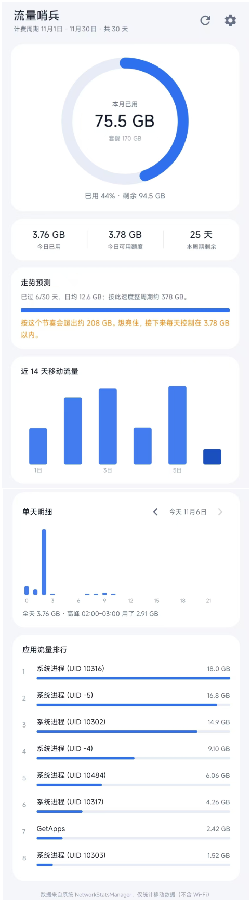

# 流量哨兵 FlowGuard

> Android 移动数据用量监测。数据直接读系统 `NetworkStatsManager`，不是自己估算的流量。

[](#)
[](#)
[](#)
[](#)
[](#license)

---

## 这是什么

运营商 App 只告诉你「已用 24.6 GB」，但不告诉你「今天还能用多少」「照这个速度月底会不会超」「昨晚 8 点那 1.2 GB 是谁吃的」。

流量哨兵解决的就是这几个问题：**按你真实的账单周期统计、预测月底结果、按小时回溯、越线主动提醒**。

它不联网、不上传、没有服务器，所有数据都在你手机本地读、本地算。

## 功能

**总览**
- 中央圆环显示本周期已用 / 套餐总量，超 85% 转橙、超 100% 转红
- 三列 KPI：今日已用、今日可用额度、本周期剩余天数
- 走势预测：按当前日均速度推算整周期用量，会超就告诉你超多少、之后每天得压到多少以内

**历史**
- 近 14 天柱状图，今天用深色柱
- **点任意一根柱子，下方的单天明细直接跳到那天**，不用一天天往前翻
- 单天明细**精确到小时**：24 根柱，点某根显示「20:00 - 21:00 · 1.21 GB」
- 单天卡片底部有汇总：`全天 3.42 GB · 高峰 20:00-21:00 用了 1.21 GB`

**应用排行**
- 默认 Top 8，底部可**展开全部**（最多 200 个应用），按用量降序
- 显示真实应用名而非进程 UID（见[为什么之前只显示 UID](#为什么之前只显示-uid)）
- **点任意一行，可以给这个 App 单独设每日上限 / 本周期上限**；设了限额的行会显示用量进度，超了标红

**外观**
- 右上角按钮一键切换白天 / 夜间，选择会被记住；长按按钮则在「跟随系统 → 浅色 → 深色」之间循环

**后台提醒**
- 套餐阈值提醒：默认 **80%**，可改 0–100，**填 0 关闭**
- 短时超速提醒：默认 **10 MB/分钟**（约 600 MB/小时），可改，**填 0 关闭**
- 单 App 超限提醒：到了你给某个 App 设的额度就提醒，每天（或每周期）只提醒一次
- 同一周期内同一阈值只提醒一次，不会每 15 分钟骚扰你
- 到 100% 时**强制再提醒一次**，不受预警开关影响

## 界面结构

```
┌─────────────────────────────┐
│  流量哨兵          ☾  ⟳  ⚙  │  ← 昼夜 / 刷新 / 套餐设置
├─────────────────────────────┤
│                             │
│        ╭─────────╮          │
│        │  24.6GB │          │  ← 进度环
│        │  / 30GB │          │
│        ╰─────────╯          │
│                             │
│   今日已用   今日额度   剩余 │
│    1.2GB     450MB    12天  │
├─────────────────────────────┤
│  走势预测                    │
│  预计月底 31.8 GB，超 1.8 GB │
│  ▓▓▓▓▓▓▓▓▓▓▓▓▒▒▒▒           │
├─────────────────────────────┤
│  近 14 天移动流量            │
│   ▁▂▃▅▂▁▄▆█▃▂▁▅▂           │  ← 点柱跳转
├─────────────────────────────┤
│  ‹   11月5日   ›            │
│   ▁▂ ▃ ▅█▆ ▂▁              │  ← 24 小时
│  20:00 - 21:00  1.21 GB     │
│  全天 3.42 GB · 高峰 20:00  │
├─────────────────────────────┤
│  应用流量排行                │
│  抖音      ▓▓▓▓▓▓▓▓ 8.2 GB  │  ← 点一行 → 设该 App 上限
│  微信      ▓▓▓▓     3.1 GB  │
│  今日 320MB / 限 500MB       │
│  ⌄ 展开全部 34 个应用        │
└─────────────────────────────┘
```

> 上图为结构示意（v1.2 布局）。真机实拍见[为什么之前只显示 UID](#为什么之前只显示-uid)（那是 v1.1 的界面）。

## 安装

**方式一：直接下载 APK**（推荐）

去 [Releases](https://github.com/mikoi6/flowguard/releases/latest) 下载 `flowguard-v1.2.apk`，传到手机安装。

直链：
```
https://github.com/mikoi6/flowguard/releases/download/v1.2/flowguard-v1.2.apk
```

首次安装时系统会提示「未知来源应用」，允许一次即可。

**方式二：自己编译**

见下方[构建](#构建)。

## 权限说明

App 一共申请四个权限，**每一个都有明确用途，没有多余权限**：

| 权限 | 用途 | 是否必需 |
|---|---|---|
| `PACKAGE_USAGE_STATS` | 读取各 App 的流量明细。这是特殊权限，只能由你在系统设置里手动授予，App 自己弹不出授权框 | 可选。不授权仍能看到总用量和曲线，只是看不到应用排行 |
| `POST_NOTIFICATIONS` | Android 13+ 发通知需要的运行时权限 | 后台提醒必需，否则任务照跑但通知发不出来 |
| `QUERY_ALL_PACKAGES` | 把流量记录里的 uid 翻译成应用名。没有它，排行里大部分行只能显示「未知应用 (UID 10316)」 | 应用排行必需（见下方说明） |
| `READ_PHONE_STATE` | 部分机型解析 `subscriberId` 需要它 | 可选。拿不到会自动降级（见[技术实现](#技术实现)） |

> `QUERY_ALL_PACKAGES` 是 Android 11 起收紧的「包可见性」权限。Google Play 对它有上架审核限制，但这个 App 是自用侧载、不上架，声明它没有合规风险。如果你要上架，就得改用 `<queries>` 白名单，届时应用名会退化成部分可解析。

**授权步骤（第一次打开时）**

1. 首屏会出现一张蓝色提示卡片，点「去授权」
2. 在系统列表里找到「流量哨兵」，打开开关
3. 返回 App，数据会自动刷新

## 使用

点右上角 ⚙ 打开设置，四个配置项：

| 配置项 | 默认值 | 说明 |
|---|---|---|
| 套餐总量 | 30 GB | 你每月套餐的移动流量总量 |
| 计费起始日 | 1 | **运营商每月扣套餐那天**。1 号重置填 1，26 号清零填 26。不是自然月 |
| 用量预警 % | 80 | 用到这里发通知。0 = 关闭 |
| 超速提醒 MB/分钟 | 10 | 短时均值超过这个速度发通知。0 = 关闭 |

> 「计费起始日」是最容易设错的一项。移动/联通/电信的账期普遍不是自然月，设错会导致整个统计周期偏移，数字对不上。去运营商 App 看一眼「账单周期」再填。

### 给单个 App 设上限

在应用排行里点任意一行，弹出「单 App 限流」，可填两个值（留空或 0 表示不限）：

| 字段 | 单位 | 重置时机 |
|---|---|---|
| 每日上限 | MB | 每天 0 点 |
| 本周期上限 | GB | 跟着套餐计费周期 |

两个可以只设一个。设好后：

- 排行行下方会多一行小字，例如 `今日 320 MB / 限 500 MB · 本周期 2.1 GB / 限 10.0 GB`，超了变红
- 后台巡检发现超限就发通知：`抖音 今天用超了｜今日已用 520 MB，超过你设的 500 MB`
- 同一天（或同一周期）同一个 App 的同一项超限只提醒一次
- 弹窗里的「清除」按钮可以取消这个 App 的所有限制

## 后台提醒的前提

这部分不配置好，提醒可能不来，属于 Android 的机制问题，不是 App 的 bug：

1. **通知权限必须允许**（Android 13+ 首次打开会弹窗）
2. **国产 ROM 要给自启动 / 后台运行权限**。MIUI / HyperOS、ColorOS、OriginOS、EMUI 等默认会杀后台任务，需要去系统设置里：
   - 允许「自启动」
   - 电池优化设为「无限制」/「允许后台运行」
3. 即使配置正确，`WorkManager` 的周期任务也会被系统延迟（省电策略下可能拖到 20–40 分钟）。所以「短时超速」的判定用的是**两次采样之间真实经过的分钟数**，不是固定的 15 分钟，避免速率虚高。

## 构建

**环境要求**

- JDK 17 或更高（工程按 Java 17 编译）
- Android SDK：`platforms;android-34` + `build-tools;34.0.0`
- Gradle 由 Wrapper 提供（8.9），不需要单独安装
- AGP 8.6.1

**步骤**

```bash
git clone git@github.com:mikoi6/flowguard.git
cd flowguard

# 1. 指定 SDK 路径（此文件不进版本库，因为里面是本机绝对路径）
echo "sdk.dir=/your/path/to/Android/Sdk" > local.properties

# 2. 编译 debug 包
./gradlew assembleDebug        # Windows: gradlew.bat assembleDebug

# 产物
# app/build/outputs/apk/debug/app-debug.apk
```

用 Android Studio 打开时不用手动建 `local.properties`，IDE 会自动写入。

> **国内网络提示**：`gradle/wrapper/gradle-wrapper.properties` 里的下载地址已经改成腾讯云镜像。官方源在国内常被限速到 20 KB/s，慢到无法完成下载。依赖（Maven Central / Google）如也慢，可在 `settings.gradle` 加阿里云镜像。

## 技术实现

**整体结构**（`app/src/main/java/com/flowguard/app/`）

| 文件 | 职责 |
|---|---|
| `MainActivity.java` | 界面编排、日期切换、异步查询调度、单 App 设限弹窗 |
| `TrafficRepo.java` | `NetworkStatsManager` 封装，唯一的数据来源；uid → 应用名解析 |
| `Period.java` | 计费周期计算（非自然月，含月末 clamp） |
| `PlanPrefs.java` | 套餐配置持久化 + 周期内总量缓存 |
| `AlertPrefs.java` | 提醒阈值持久化 + 采样状态 |
| `AppLimitPrefs.java` | 单 App 限额持久化 + 超限提醒去重 |
| `UiPrefs.java` | 昼夜模式持久化与切换 |
| `RingView.java` | 自绘进度环 |
| `BarChartView.java` | 自绘柱状图（支持稀疏刻度、点击选中） |
| `GuardWorker.java` | 后台巡检：超速 / 套餐阈值 / 单 App 限额 |
| `GuardScheduler.java` | WorkManager 任务注册（15 分钟周期 + 立即执行一次） |
| `Notifier.java` | 通知渠道与通知构建 |
| `Fmt.java` | 流量 / 日期格式化 |

**几个关键决策**

*没有常驻后台服务。* 系统的流量统计本身就是按时间段可查的历史记录，不需要自己实时累计。打开 App 时查一次就行，不耗电。唯一常驻的是 `WorkManager` 的 15 分钟周期任务，只在发通知时唤醒。

*按小时查询是 24 次分别求和。* Android 没有「按小时聚合」的接口，只能把一天切成 24 段，每段单独调一次 `queryDetailsForUid`。这 24 次查询全在后台线程执行，首次进入某天约半秒，之后走内存缓存。快速连点切换日期时用请求序号丢弃过期结果，防止数据显示错乱。

*`subscriberId` 的兼容处理。* Android 10 之后普通应用读不到 IMSI，硬编码 `subscriberId` 会直接抛 `SecurityException`。代码按 `null → IMSI` 顺序逐个尝试，谁通用谁。部分定制 ROM 两种都失败，此时兜底为「显示上次结果 + 提示」。

*非自然月账期。* `Period.java` 把「起始日 → 下个周期起始日」折算成时间戳区间，包括 2 月只有 28 天时把 31 号 clamp 到月末。所有统计都以这个区间为准，而不是 `Calendar.MONTH`。

*超速判定要防小样本。* 单纯用「增量 ÷ 时间」会在样本太小时失真——5 分钟用了 30 MB 也能算出 6 MB/分钟。所以额外要求增量 ≥ 50 MB 才判定，否则跳过这次采样。

*昼夜切换靠 DayNight 资源，不是两套布局。* 主题继承 `Theme.Material3.DayNight.NoActionBar`，配一份 `values-night/colors.xml`，所有 `@color/xxx` 引用自动切到深色值；代码里用 `AppCompatDelegate.setDefaultNightMode()` 切换，Activity 自动重建，自绘控件（进度环、柱状图）在构造时重新取色，对话框和状态栏也一并跟着变。代价是切换时有一次重建，所以模式必须在 `setContentView` 之前应用，否则会先白闪一下。

### 为什么之前只显示 UID

v1.1 的排行里有大量行显示「系统进程 (UID 10316)」，原因是 Android 11 的**包可见性（package visibility）**收紧：

- `NetworkStatsManager` 返回的是流量记录里的 **uid**，要变成应用名得问 `PackageManager.getPackagesForUid(uid)`
- 从 Android 11 起，targetSdk ≥ 30 的应用**默认只能看到自己「可见」的包**，对其它包这个方法直接返回 `null`
- 于是查不到名字，只能退回显示 uid —— 而这跟「系统进程」其实毫无关系，10316 就是某个普通 App 的 uid



<sub>v1.1 的真机实拍（夜间样式尚未加入）。注意排行里除 GetApps 外全是「系统进程 (UID xxxxx)」，那些其实都是有名字的应用。</sub>

修法是三层兜底（`TrafficRepo.resolveIdent`）：

1. 声明 `QUERY_ALL_PACKAGES`，让 `getPackagesForUid` 能正常工作
2. 仍失败时扫一遍 `getInstalledApplications()`，自建 `uid → ApplicationInfo` 索引
3. 再失败时：AOSP 固定 uid（1000 系统 / 1001 电话 / 1002 蓝牙 / 1013 媒体 / 2000 Shell）给中文名，其余标「未知应用 (UID x)」——这时才是真的解析不出来（比如应用已卸载）

共享 uid（如 Google 服务框架的一个 uid 对应多个包）会显示成 `Google Play 服务 等 3 个`，避免看起来像重复项。

## 已知限制

- **只统计移动数据**，Wi-Fi 不计入（这是有意设计：监测的是套餐用量）
- **debug 签名**，仅供自用和测试，未上架任何应用商店
- v1.1 已在真机跑通（读取、图表、授权流程正常）。**v1.2 新增的昼夜切换、排行展开、单 App 限流通知仍是编译级验证**，没在真机上点过，遇到异常请提 issue
- 部分定制 ROM 对 `NetworkStatsManager` 有额外限制，可能返回空数据；代码已兜底为提示，但无法绕过系统层面的封锁
- 分应用明细依赖 `PACKAGE_USAGE_STATS`。未授权时应用排行会显示为空，并提示去授权（顶部同时出现蓝色授权卡片），总用量与曲线不受影响
- 应用名解析依赖 `QUERY_ALL_PACKAGES`。主动去掉这个权限的话，排行会退化成 UID 列表

## License

MIT
